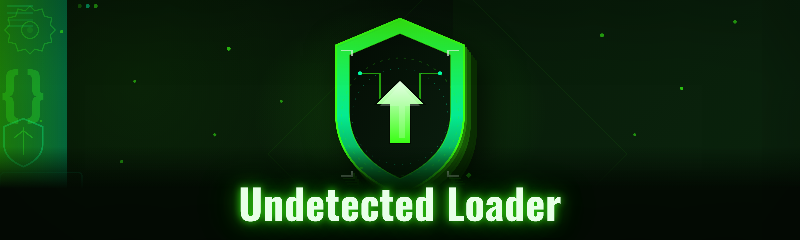

  
  
  

  

  
  
  

---

Undetected loader for veil-runner: HWID spoofer, signature bypass, manual-map injection, driver-level anti-cheat evasion

## Overview

Undetected loader for veil-runner: HWID spoofer, signature bypass, manual-map injection, driver-level anti-cheat evasion

  

## License

[MIT License](LICENSE)

  

